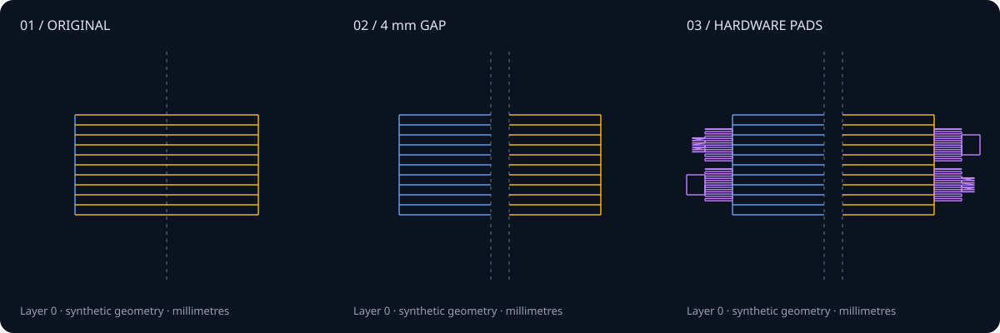
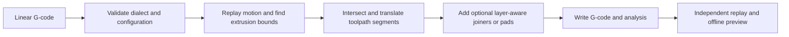

# E3P Studio · Offline toolpath geometry

Split a sliced G-code model into two separated halves while keeping earlier raft layers intact. This focused extract from a larger CAD and print-preparation project tracks motion and extrusion, divides crossing segments at a cut plane, inserts nonextruding transfers, and can add outside joiners or tapered hardware pads.



**Try the offline visual:** download the repository and open [`demo/index.html`](demo/index.html) in a browser. Select a layer, compare the three transformations, and reveal travel paths. The viewer embeds its data and makes no network requests. The SVG above and all displayed measurements come from the included synthetic G-code.

## Run

Python **3.11+**; no runtime dependencies, slicer, CAD kernel or device connection.

```sh
python -m pip install .
e3p-gcode-split demo/synthetic.gcode --output preview-output/split.gcode --gap-mm 4
python -m unittest discover -s tests -v
python tools/build_demo.py --check
```

The CLI writes a new G-code file and JSON analysis report. The default cut is the midpoint of positive-extrusion bounds on the selected axis. Use `--axis y`, `--coordinate-mm`, `--split-start-layer`, `--wire-loops`, or `--outside-frame`; see `e3p-gcode-split --help`. Gap values below 2 mm retain the original algorithm's 2 mm minimum. That minimum is a geometry setting, not a validated physical clearance.

## What the example demonstrates

The fixture has six tapered rectangular model layers, nine raster paths per layer, and one raft outline. It uses a cut at X = 40 mm and a 4 mm gap. A separate replay module measures the generated commands:

| Model layers only | Printing segments | XY printing length (mm) | Commanded extrusion (mm) | Segments entering the gap |
| --- | ---: | ---: | ---: | ---: |
| Original | 78 | 2,385.000 | 95.400 | — |
| Separation only | 144 | 2,385.000 | 95.400 | 0 |
| Outside joiners | 444 | 3,140.493 | 125.620 | 0 |
| Hardware pads | 840 | 4,527.062 | 181.082 | 0 |

The base split preserves this fixture's printing length and extrusion. Added features deliberately consume extra material. The raft text is unchanged in every variant. These are computed synthetic results, not print tests or measured physical performance. Exact values, input/output hashes and transform counters are in [`demo/metrics.json`](demo/metrics.json).

## How it works



`gcode_split.py` retains the original multi-pass geometry implementation. It distinguishes travel from positive extrusion, apportions a crossing segment's extrusion by length, and tracks emitted position separately from input position. Transfer moves retract, lift, cross, lower and prime, then restore the known source feed. Joiner stations use outside anchors; pads follow the layer's bounds rather than a fixed bounding box.

`validation.py` defines the bounded input contract. `inspection.py` independently replays linear commands to measure output geometry. `tools/build_demo.py` generates the fixture, three variants, quantitative evidence, SVG and standalone viewer; `--check` regenerates all seven artifacts in a temporary directory and compares their bytes.

## Supported input and limits

- UTF-8, whitespace-delimited numeric words, millimetres, explicit **G90** absolute XYZ and **M82** absolute extrusion, and Cura-style `;LAYER:n` comments. Establish XYZ before extruding. `G92 E…` resets are supported.
- Planar **G0/G1** motion. Arcs, relative modes, inch units, coordinate-system resets, homing/macros, unknown commands, nonfinite values, and combined XY retraction are rejected before output is created. `validation.PARAMETERS` lists the small set of accepted control commands. G21 may be omitted when the input already uses millimetres. If no F value precedes printing, the source feed is unknown; feed equivalence is only checked for inputs that declare it.
- Output coordinates are rounded to 0.001 mm and extrusion to 0.00001 mm. Extruding moves exactly on the cut plane are dropped and their extrusion coordinate is reset, so their material is not deferred onto the next move. The cut must lie inside the selected axis's extrusion bounds.
- Existing input/output/report aliases, including hard links, are rejected. This is a local file-processing tool, not a concurrent file service or a crash-transactional storage system.
- No printer envelope, collision model, acceleration model, temperature process, fit tolerance, or physical joiner strength is validated. The package neither uploads nor executes G-code. Generated examples are inspection fixtures, not printer-ready jobs.

## Verification and provenance

The suite contains **22 test methods**: six preserved splitter tests, fifteen maintenance/contract regressions, and one deterministic geometry test with **80 cases** across X/Y cuts, both crossing directions and nonextruding travel. It checks deposition, path length, feed restoration, gap occupancy, mode rejection, extrusion resets, raft retention, output aliases and generated features. CI also reproduces the demo, builds a wheel, and exercises the installed CLI outside the source checkout.

This is a bounded extraction from Derek Poe's E3P Studio workspace, not a release of the full application. The source workspace also contained STEP meshing, Cura integration, Blender mold construction and device control. Those components and their external dependencies are outside this package. No downloaded models, runtime device settings, camera data, vendored Three.js/HLS code or third-party assets are included.

The maintenance changes fix feed restoration after injected moves, transitions at cut-plane endpoints, extrusion accounting for dropped plane moves, per-layer feature placement before trailing travel and control commands, repeated-coordinate no-ops, and input-file alias handling. They also make previously implicit dialect restrictions explicit. See [`docs/provenance.md`](docs/provenance.md) for the source map and scope. All tests and visual evidence here are offline; no hardware validation is claimed.

MIT License — Derek Poe.
